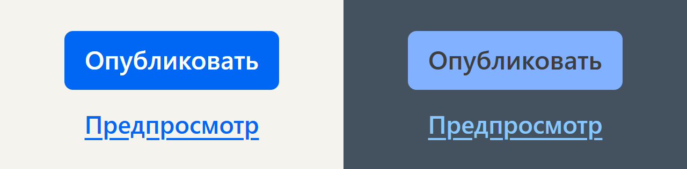
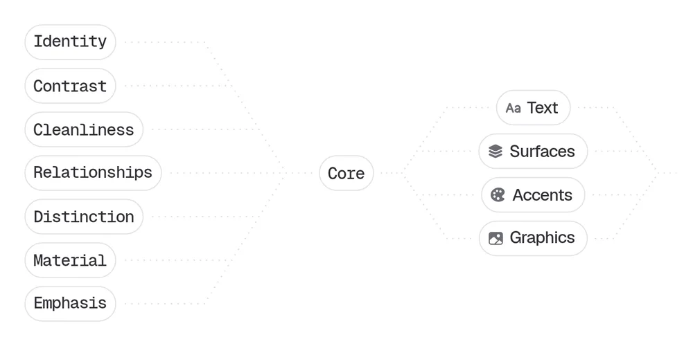

# Lab Colors

Библиотека адаптивных цветов для интерфейсов и дизайн-систем.

Задайте исходные цвета, поверхности и связи между ними. При изменении
окружения Lab Colors пересчитывает цвета с учётом характера исходной
композиции и заданных ограничений. Не нужно составлять отдельную палитру
для каждой темы.

<a href="docs/media/theme.mp4">
  <picture>
    <source media="(prefers-reduced-motion: reduce)" srcset="docs/media/theme-still.webp">
    
  </picture>
</a>

## Как это работает

Кнопка и ссылка могут использовать один фирменный синий, но получать
разные оттенки. Ссылка должна читаться на странице, а надпись на кнопке — на её
заливке. Lab Colors учитывает эти связи при подборе цветов.



Между этими снимками изменился только входной цвет фона. На грифельном
фоне кнопка и ссылка стали светлее, а надпись на кнопке — тёмной.
Исходные цвета остались прежними.

### Связи в дизайн-системе

Исходный цвет задаёт характер роли. Каждое её применение связано с
конкретной поверхностью, а вычисленная заливка сама может стать фоном для
другого цвета. Один и тот же принцип работает для вложенных поверхностей
и полупрозрачных материалов.

Дизайн-система определяет, какие свойства нужно сохранить: контраст текста,
тональные отношения, различимость акцентов и характер материалов. Связанные
цвета рассчитываются вместе, а обязательные условия проверяются для всего
результата. Имена ролей и структуру поверхностей задаёт приложение.

<a href="docs/media/relationships.mp4">
  <picture>
    <source media="(prefers-reduced-motion: reduce)" srcset="docs/media/relationships-still.webp">
    
  </picture>
</a>

## Попробовать в браузере

```sh
npm install @labpics/colors
```

```js
import { colors } from "@labpics/colors";

const original = { canvas: "#f5f3ed" };
const c = colors({ reference: original });
const canvas = c.surface("canvas");
const accent = c.role("accent", "#0067f4");
const ink = c.role("ink", "#ffffff");
const action = accent.on(canvas);

const program = await c.compile({
  action,
  actionLabel: ink.on(action, { contrast: "wcag22-text" }),
  link: accent.on(canvas, { contrast: "wcag22-text" }),
});
const view = program.attach(document.querySelector(".app"), original);
view.set({ canvas: "#44515f" });
```

Кнопка получает фон из `var(--action)` и цвет надписи из `var(--actionLabel)`,
ссылка — из `var(--link)`. Ядро на Rust поставляется в пакете как WASM.
При обновлении через `view.set` фон и связанные цвета применяются вместе;
если новый контекст не принят, интерфейс сохраняет прежнее состояние.
[Полный пример с HTML и CSS](packages/colors/README.md#первый-запуск-в-браузере).

## Качество цвета

Контраст — одно из условий читаемости, а не мера качества композиции.
Отдельная задача Lab Colors — Cleanliness: сохранение или улучшение
воспринимаемой чистоты композиции без потери авторского замысла. Сейчас
поддерживаются отдельные случаи; общей модели для целых цветовых полей
пока нет. [Научные основания и состояние реализации](docs/explanation/color-quality.md).

## Документация

- [JavaScript и WASM](packages/colors/README.md) · [Rust](crates/labcolors-core/README.md) · [Swift](bindings/swift/DISTRIBUTION.md) · [Kotlin](bindings/kotlin/README.md) · [CLI](crates/labcolors-evaluate-cli/README.md)
- [Как задать характер, материал и иерархию](docs/explanation/color-system.md) · [Как переносится исходная композиция](docs/explanation/reference-appearance.md)
- [Архитектура](docs/whitepaper.md) · [Воспроизводимые замеры производительности](docs/how-to/benchmark-program.md)
- [Сборка и проверка библиотеки](docs/how-to/develop.md) · [Все руководства](docs/README.md)

## Лицензии

Код распространяется по [MIT](LICENSE). Для встроенных данных действуют
CC-BY-4.0 и CC-BY-SA-4.0. [Источники и условия использования](crates/labcolors-core/NOTICE.md).
