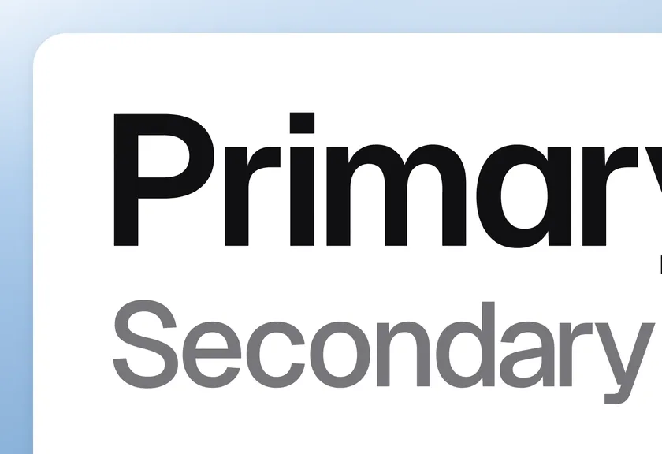

# Lab Colors

Задайте опорные цвета и связи между элементами один раз. Lab Colors подберёт
оттенки для каждой поверхности и обновит их, когда изменится фон.

<a href="docs/media/theme.mp4">
  <picture>
    <source media="(prefers-reduced-motion: reduce)" srcset="docs/media/theme-still.webp">
    
  </picture>
</a>

## Как это работает

У кнопки и ссылки один фирменный синий. Ссылка должна читаться на странице,
а надпись — на самой кнопке. Дизайнер задаёт эти связи. Ядро Rust подбирает
оттенки с учётом того, на каком фоне виден каждый элемент.


Между этими снимками приложение поменяло только фон страницы. На грифельном
фоне кнопка и ссылка стали светлее, а белая надпись на кнопке — тёмной.

### Связи в дизайн-системе

Ваша команда решает, какие элементы связаны. Например, прозрачность заливки
меняет фон для надписи, а два акцента в одной диаграмме должны оставаться
различимыми.

<a href="docs/media/relationships.mp4">
  <picture>
    <source media="(prefers-reduced-motion: reduce)" srcset="docs/media/relationships-still.webp">
    
  </picture>
</a>

## Попробовать в браузере

```sh
npm install @labpics/colors
```

```js
import { colors } from "@labpics/colors";

const original = { canvas: "#f5f3ed" };
const c = colors({ reference: original });
const canvas = c.surface("canvas");
const accent = c.role("accent", "#0067f4");
const ink = c.role("ink", "#ffffff");
const action = accent.on(canvas);

const program = await c.compile({
  action,
  actionLabel: ink.on(action, { contrast: "wcag22-text" }),
  link: accent.on(canvas, { contrast: "wcag22-text" }),
});
const view = program.attach(document.querySelector(".app"), original);
view.set({ canvas: "#44515f" });
```

Кнопка получает фон из `var(--action)` и цвет надписи из `var(--actionLabel)`,
ссылка — из `var(--link)`. [Полный пример с HTML и CSS](packages/colors/README.md#первый-запуск-в-браузере).

## Документация

- [JavaScript и WASM](packages/colors/README.md) · [Rust](crates/labcolors-core/README.md) · [Swift](bindings/swift/DISTRIBUTION.md) · [Kotlin](bindings/kotlin/README.md) · [CLI](crates/labcolors-evaluate-cli/README.md)
- [Как задать характер, материал и иерархию](docs/explanation/color-system.md) · [Как переносится исходная композиция](docs/explanation/reference-appearance.md)
- [Cleanliness — что умеют модели и на каких исследованиях они основаны](docs/explanation/color-quality.md)
- [Сборка и проверка библиотеки](docs/how-to/develop.md) · [Все руководства](docs/README.md)

## Лицензии

Код распространяется по [MIT](LICENSE). Для встроенных данных действуют
CC-BY-4.0 и CC-BY-SA-4.0. [Источники и условия использования](crates/labcolors-core/NOTICE.md).
